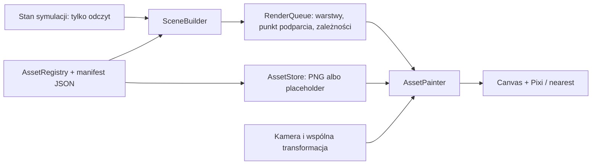

# Kontrakt graficzny PixelHub 0.2

Implementacja obsługuje wymienne PNG. Lokalna integracja pakietu grafik v1 dostarcza wszystkie zasoby bieżącego katalogu; nie dodaje nowych zasad składowania. Pozycje, kolizje, transport, paleciak, rampy, kampania, pieniądze i zapis pozostają w istniejącej symulacji.

## Przepływ danych



Ten sam `AssetPainter` obsługuje PNG i zastępcze kształty. `SceneBuilder` przekazuje identyfikatory, klatki, kierunki, punkty świata i zależności. Nie zna nazw plików. Brak PNG ani błędny rozmiar atlasu nie zatrzymują symulacji.

## Moduły

| Plik | Odpowiedzialność |
|---|---|
| `src/graphics/config.ts` | 24 px źródła, bazowa skala 2, kamera, warstwy, wysokość uniesienia, wymiary modułów pojazdu |
| `src/graphics/assets.ts` | Definicje, kierunki, klatki, kotwice, punkty dłoni, moduły i placeholdery |
| `src/graphics/animation.ts` | Wybór stanu i klatki na podstawie faktycznej długości trajektorii; oddzielna orientacja pracownika i korpusu |
| `src/graphics/engine.ts` | Loader, fallback, rysowanie, nine-slice, transformacje lokalnych socketów, kolejka warstw |
| `src/graphics/scene.ts` | Odczyt świata, kompozycja pracownika, paleciaka i ładunku, kafelki, ściany, wyposażenie, pojazdy i przyszłe regały |
| `src/renderer.ts` | Adapter canvasa, trafianie w obiekty, diagnostyka, podgląd zasobów |
| `public/assets/catalog.json` | Generowany pełny kontrakt wszystkich zarejestrowanych zasobów dla grafika |
| `public/assets/manifest.json` | Opcjonalne nadpisania ścieżek, kotwic, prostokątów klatek, socketów i podziału warstw |
| `scripts/export-assets.ts` | Eksport katalogu, uruchamiany również przy buildzie |

## Skala i kamera

- Jednostka źródłowa: **24×24 px**. Bazowa skala: **2**. Jedno pole: **48×48 px**. Podłoga 20×6: **960×288 px**.
- `Camera.worldToScreen` i `Camera.screenToWorld` są wzajemnie odwrotne. `screenToGrid` wskazuje pole; `clientToCanvas` uwzględnia pozycję i rozmiar canvasa w DOM, również po przewijaniu.
- `tileCenter` dodaje pół pola wyłącznie w adapterze grafiki. Stary model zapisuje pozycję zestawu względem indeksów pól; pozycje w symulacji nie są przesuwane. Stopy pracownika, oś paleciaka i środek palety są przypinane do odpowiadającego im środka pola / ułamkowej pozycji.
- Kamera obsługuje pan oraz zoom 0,25–4. Przyciski zmieniają zoom o 0,5, co daje całkowite powiększenia pikseli źródłowych. `Reset kamery` przywraca ×2 źródła. Przesuwanie: środkowy przycisk myszy albo Spacja + przeciągnięcie.
- Rozmiar powierzchni wynika z aktualnej hali, pojemności pojazdów i miejsca na ich wjazd. Nie jest ograniczony do 1400×650. Przy powiększeniu można przewijać obszar sceny lub przesuwać kamerę.
- PNG używają nearest-neighbor, canvas ma wyłączone wygładzanie, a CSS `image-rendering: pixelated`. Napisy pozostają dynamicznym tekstem z polskimi znakami.
- Elementy `space: "screen"` i nine-slice interfejsu zachowują ekranowe położenie i skalę podczas zmiany kamery świata.

## Jak podmienić placeholder

1. Odczytaj zasób z `public/assets/catalog.json`: `id`, `path`, rozmiary, kotwicę i prostokąty klatek.
2. Umieść PNG RGBA pod wskazaną ścieżką w `public/`. Przykład: `cargo/box/blue` wskazuje `public/assets/cargo/box/blue.png`. Samo dodanie poprawnego pliku i przeładowanie strony zastępuje placeholder.
3. Jeżeli chcesz inną lokalizację, dodaj wpis do `public/assets/manifest.json`:

```json
{
  "version": 1,
  "assets": {
    "cargo/box/blue": {
      "path": "assets/cargo/custom-blue.png"
    }
  }
}
```

Nie zmieniasz kodu gry, kolizji ani ustawienia palet. Można też nadpisać `anchorX`, `anchorY`, `frames`, `parts`, `attachmentPoints` lub `nineSlice`. Prostokąty atlasu są w pikselach źródłowych. Zasoby mogą współdzielić plik atlasu i mieć różne rozmiary klatek; nie trzeba umieszczać wszystkiego na siatce 24×24.

Jeśli bitmapa jest niedostępna lub za mała na deklarowane klatki, loader zachowuje placeholder i podaje przyczynę w diagnostyce. Przy pustym katalogu docelowych grafik odpowiedzi 404 dla przyszłych PNG są spodziewane; nie są błędami symulacji.

`catalog.json` jest wynikiem eksportu, nie drugim niezależnym źródłem konfiguracji. Zmiany samego kontraktu wprowadza się w centralnym rejestrze, potem uruchamia `npm run assets:manifest`. Build robi to automatycznie.

## Postać i paleciak

Kolejność ośmiu kierunków: **N, NE, E, SE, S, SW, W, NW**. Klatki postaci mają 24×24, kotwicę stóp (12,21), trzy punkty dłoni i chwytu w każdej klatce.

| Stan | Klatki na kierunek | Łącznie | Domyślny arkusz z odstępem 1 px |
|---|---:|---:|---|
| idle | 2 | 16 | 49×199 |
| walk | 4 | 32 | 99×199 |
| pull | 4 | 32 | 99×199 |
| push | 4 | 32 | 99×199 |

Razem **112 klatek**. Domyślnie kierunki są w wierszach, klatki w kolumnach; katalog zawiera jawne prostokąty. Odstępy muszą pozostać przezroczyste. Identyfikator kierunkowy, np. `worker/default/pull/NW`, rozwiązuje się do odpowiedniego wiersza arkusza.

`walk`, `pull` i `push` wykonują cykl czterech klatek na jedno przebyte pole. Dystans pochodzi z trajektorii `TransportStep`, także na łukach i przy pomijaniu kroków między renderami. Nie jest funkcją liczby wyrenderowanych klatek. Pchanie i ciągnięcie są oddzielnymi zasobami; przełączanie postawy zatrzymuje cykl ruchu. `idle` ma spokojny cykl. Loader/rejestr rozróżnia pętlę, animację jednorazową i klatki statyczne.

Korpus paleciaka ma 16 kierunków co 22,5°, od N zgodnie z ruchem wskazówek zegara. Domyślny arkusz ma 24×399 px. Dla PNG wybierana jest klatka kierunkowa — nie obracamy bitmapy zamiast korzystać z dostępnych kierunków. Pracownik dobiera kierunek według wektora od przegubu do postaci, korpus według osi z `transportGeometry.heading`.

Korpus, postać i dyszel to oddzielne komendy i zasoby. Korpus korzysta z `back`, przegub z `hitch`, postać z `head`. Dyszel 16×8 łączy (0,4) z nominalnym końcem (14,4); obraca się i rozciąga wyłącznie wzdłuż osi X do `gripSocket` aktualnej klatki postaci. Obliczenia nie zmieniają stałych mechaniki **0,42 / 0,58 pola**. Testy sprawdzają zerową lukę geometryczną na całych łukach pchania i ciągnięcia.

## Ładunek, warstwy i otoczenie

- Paleta i skrzynia są oddzielnymi zasobami 24×24 z kotwicą (12,12). Jedna rzeczywista paleta zachowuje jeden identyfikator i jedną kolizję. Kolory oraz MIX, temperatura, priorytet, uszkodzenie i zwrot są niezależnymi nakładkami.
- `forkHeight` przesuwa obraz pionowo o **0–3 px źródła / 0–6 px przy ×2**, również przy obrocie skrzyni. Cień zostaje na podłodze. Zależność paleciak → paleta → skrzynia utrzymuje zasłanianie wideł przed pobraniem i po opuszczeniu.
- Warstwy: 0 tło, 10 podłoga, 20 oznaczenia, 30 cienie, 40 konstrukcja tła, 100 obiekty, 200 konstrukcja przodu, 300 efekty, 400 UI. W obrębie obiektów sortujemy po punkcie podparcia o podłogę, nie po górze klatki. Zależności wewnętrzne są stabilnie rozwiązywane bez przenoszenia ładunku ponad warstwę pierwszego planu.
- Ściany 24×36 z kotwicą (12,24) mają deklarowany podział `parts` na część tła i przodu. Cała hala, bramy i pomieszczenia są składane z modułów. Wymiary pomieszczeń i wyposażenia wynikają z obecnych danych mapy; układ nie został zmieniony.
- Regał jest wyłącznie przyszłą kompozycją graficzną. N segmentów wykorzystuje N+1 współdzielonych słupków. Nie dodano składowania na regałach. Grafik powinien przygotować segment bez zdublowanych zewnętrznych słupków.
- Pojazdy mają wspólną kabinę, powtarzane segmenty ładowni, zakończenie, sloty i koła. Każdy segment odpowiada dwóm istniejącym slotom. Pojemność pochodzi z CMR. Długości 4/6/8/10 palet to 80/104/128/152 px źródła; koła należą do osi całego pojazdu, nie każdego segmentu. Teksty nie podlegają odbiciu kabiny. Podłoga ładowni jest renderowana pod ładunkiem, bez zasłaniającego sloty dachu.

`footprint` w zasobie jest opisową metadaną. Nie rejestruje przeszkód. Rzeczywisty obrys w diagnostyce pochodzi z dotychczasowej geometrii symulacji, również dla ładunku i wieloczęściowego zestawu.

## Diagnostyka i testy

Dodaj `?dev=1&graphics=1` do adresu gry, aby korzystać z osobnego zapisu testowego i otworzyć diagnostykę.

- **G** pokazuje kotwice, środki pól, prostokąty klatek, dłonie, połączenie uchwytu i obrys logiczny.
- Panel zasobów pozwala wybrać asset, kierunek i klatkę, obejrzeć metadane oraz modułowy regał i pojazdy 4/6/8/10.
- „Raport kotwic, połączeń i zasobów” pokazuje stan loadera, przyczyny fallbacku i lukę uchwytu w pikselach źródłowych.

```sh
npm test
npm run build
# Przy działającym npm run preview -- --port 5173:
npm run test:browser
npm run test:graphics
```

Nowe testy sprawdzają skalę, odwrotność transformacji, hit-test po zoomie i przewinięciu, 112 klatek, kierunki 8/16, sockety, dystans, zmianę postawy, anulowanie, podnoszenie, cienie, kolejność widły–ładunek, moduły, atlas, fallback i nine-slice niezależny od kamery.

Test przeglądarkowy generuje w pamięci wyłącznie techniczne wzorce RGBA: kafelek pasków, kolorowy atlas klatek i jednolity wzorzec skrzyni. Weryfikuje prawdziwe dekodowanie PNG, wybór kierunku/klatki, brak interpolacji kolorów, widoczność skrzyni na samochodzie oraz brak zapisów renderera do symulacji. Wzorce nie są finalnymi grafikami i nie trafiają do katalogu assetów gry.

Pozostałe granice: placeholdery są celowo proste; nie dodano finalnego artu, nowych typów maszyn, fizyki regałów ani nowego ruchu po skosie. Pełny obrys kolizji pozostaje autorytetem symulacji.
